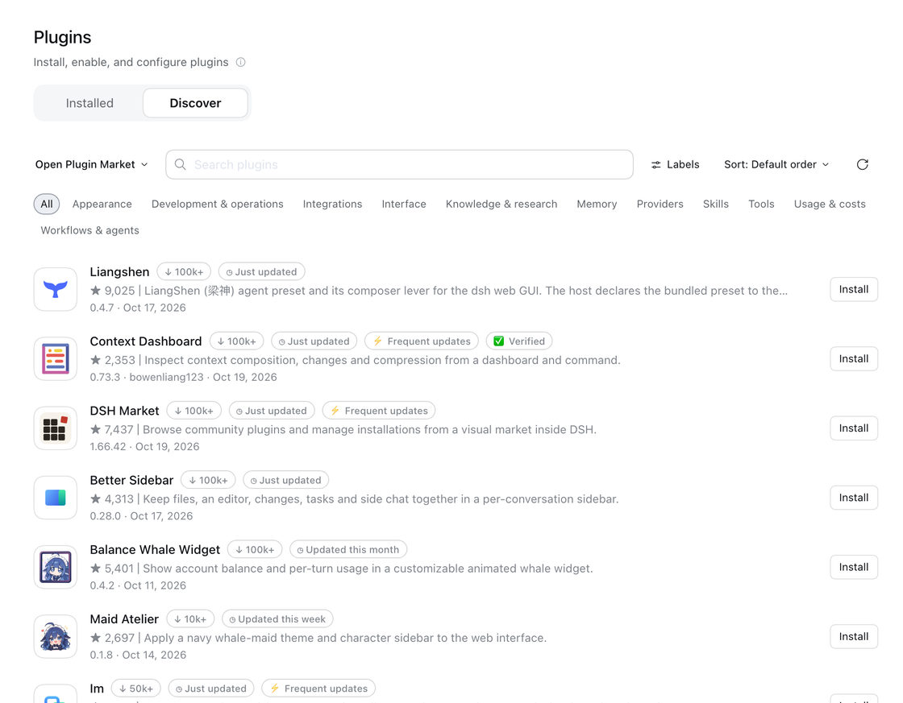
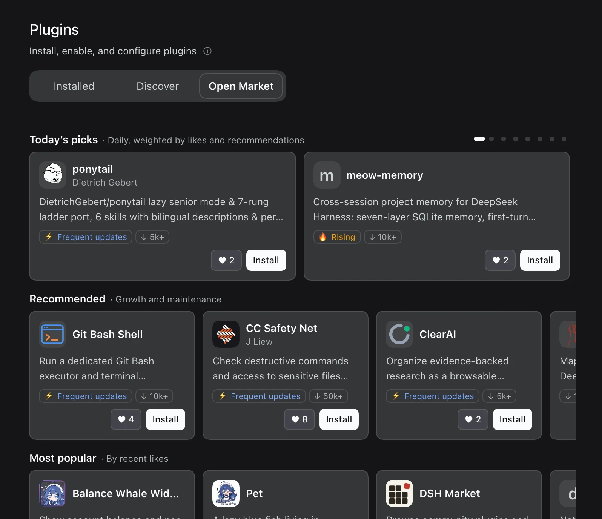
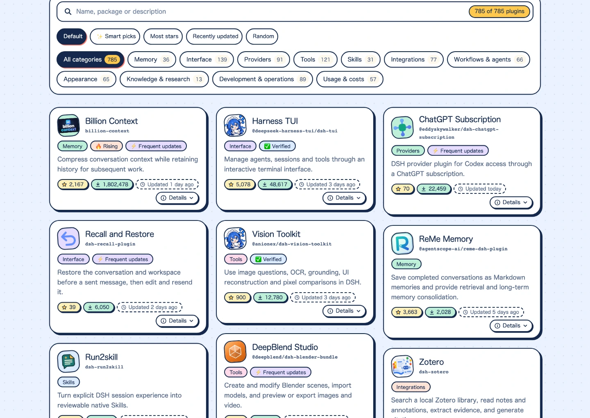

<div align="center">


# Open Plugin Market

[](https://dshopen.org/)
[](https://dshopen.org/stats.json)
[](https://dshopen.org/stats.json)
[](https://github.com/polang233/dsh-plugin-index/stargazers)
[](https://www.npmjs.com/package/dsh-open-market)
[](https://dshopen.org/plugins/dsh-open-market/)

[Website](https://dshopen.org/) &nbsp;|&nbsp; [Usage stats](https://dshopen.org/stats/) &nbsp;|&nbsp; [Submit a plugin](https://github.com/polang233/dsh-plugin-index/issues/new?template=plugin-add.yml) &nbsp;|&nbsp; [简体中文](README.md)

</div>

A community **plugin market** for DeepSeek Harness (DSH). Add it as an **index source** in the official Discover tab, or install the plugin for a standalone Open Market page inside DSH.

**Stars aren't everything.** The default picks refresh every day and put fast-growing, actively shipped, genuinely good plugins first, with verification, downloads and stars as supporting signals. Established favourites can't hog the list, so new projects and newcomers' plugins get a chance at the first screen and a wider audience.

## Quick start

**Option 1: Add the index source.** switch on **Custom plugin markets** under **Plugins → Experimental plugins**, then go to **Discover → Add index source** and paste:

```text
https://dshopen.org/index.json
```

<p> </p>

**Option 2: Install the plugin.** Run the command below; [`dsh-open-market`](https://www.npmjs.com/package/dsh-open-market) switches on Custom plugin markets and adds the index for you, from the next start of DSH.

```bash
dsh plugin --profile desktop add dsh-open-market
```

It also adds an **Open Market** tab to the Plugins page: today's picks and rows ranked by likes and growth. Open a card for details, likes and install.



[](https://dshopen.org/)



## Labels and sorting

✅ Verified · 🔥 Rising · ⚡ Frequent updates (10+ releases in 30 days) · ◷ four update-age buckets · ↓ seven download tiers · ♥ likes from the Open Market tab (once per person, plugin and day, including installs; each plugin loses one every three days). *Default* rotates ten front-page plugins daily from a weekly pool of about seventy qualified entries. *✨ Smart picks* also changes daily, with mostly random rotation and a small preference for recent updates and growth. Entries shown this week move down, and next week reshuffles the pool. *Random resources* reshuffles independently each day. The index rebuilds every six hours; rotation follows calendar days in UTC+8. See [metrics and exposure history](docs/market-display.md).

## Submit a plugin

[Open a request](https://github.com/polang233/dsh-plugin-index/issues/new?template=plugin-add.yml): plugins need public source code, an installable npm release and a declared license (a pinned Git commit works with maintainer approval; see the [contributing guide](.github/CONTRIBUTING.md)). Plugins with their own logo and a complete description are reviewed first. To take one down, [request removal](https://github.com/polang233/dsh-plugin-index/issues/new?template=plugin-remove.yml).

Once listed, put the badge in your README. It shows likes and links to your plugin's page here. Replace `dsh-pet` with your package name (`%40scope/name` for a scoped one):

```md
[](https://dshopen.org/plugins/dsh-pet/)
```

[](https://dshopen.org/plugins/dsh-pet/)

## Spare a star ⭐

A star is the simplest thank-you a developer gets, and it feeds the recommendations here too. If a plugin earns a place in your setup, star its repo. The next star could be someone starring yours.

<a href="https://www.star-history.com/#polang233/dsh-plugin-index&Date">
  <picture>
    <source media="(prefers-color-scheme: dark)" srcset="https://api.star-history.com/svg?repos=polang233/dsh-plugin-index&amp;type=Date&amp;theme=dark">
    
  </picture>
</a>

[Maintenance](docs/maintenance.md) · [GPL-3.0 license](LICENSE)

Independent community project, not affiliated with DeepSeek. Plugins retain their authors' copyrights and licenses.
