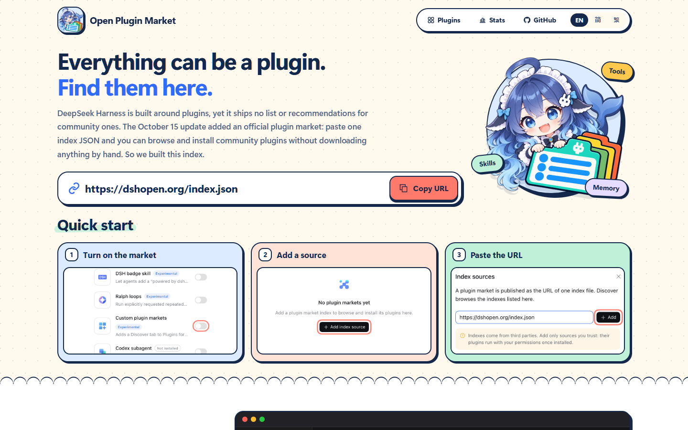

# Open Plugin Market


In DeepSeek Harness, switch on **Plugins → Experimental plugins → Custom plugin markets**, then go to **Discover → Add index source** and paste:

```text
https://dshopen.org/index.json
```

[](https://dshopen.org/)
[](https://dshopen.org/stats.json)
[](https://dshopen.org/stats.json)
[](https://github.com/polang233/dsh-plugin-index/stargazers)

A community plugin market for DeepSeek Harness (DSH): driven by data and recommendations, with nothing extra in the way.

**Stars aren't everything.** The default picks refresh every day and put fast-growing, actively shipped, genuinely good plugins first, with verification, downloads and stars as supporting signals. No single author can flood the list, so a newcomer's plugin can make the first screen and find its audience.

[Browse plugins](https://dshopen.org/) · [简体中文](README.md) · [Suggest a plugin](https://github.com/polang233/dsh-plugin-index/issues/new?template=plugin.yml)


[](https://dshopen.org/)


## Use it

Switch on **Custom plugin markets** under **Plugins → Experimental plugins**, then pick one:

- **Add the source by hand.** Paste `https://dshopen.org/index.json` into **Discover → Add index source**. The earlier `https://polang233.github.io/dsh-plugin-index/index.json` still works.
- **Install the plugin.** `dsh plugin --profile desktop add "git+https://github.com/polang233/dsh-plugin-index.git#main&path:/packages/dsh-open-market"` installs `dsh-open-market`, which adds the source for you once. Remove it later and it stays removed.


## Labels and sorting

✅ Verified · 🔥 Rising · ⚡ Frequent updates · ◷ four update-age buckets · ↓ seven download tiers. *Default* rotates ten front-page plugins daily from a weekly pool of about seventy qualified entries. *✨ Smart picks* also changes daily, with mostly random rotation and a small preference for recent updates and growth. Entries shown this week move down, and next week reshuffles the pool. *Random resources* reshuffles independently each day. The index rebuilds every six hours; rotation dates use Asia/Taipei. See [metrics and exposure history](docs/market-display.md).

## Spare a star ⭐

A star is the simplest thank-you a developer gets, and it feeds the recommendations here too. If a plugin earns a place in your setup, star its repo. The next star could be someone starring yours.

## Usage stats

*Index usage* counts every time DSH loads this market from dshopen.org, which happens when Discover opens or refreshes (DSH caches it for about ten minutes). *Usage today* is today's share. Readers are deduplicated per day with a salted hash of IP and user agent; IPs are never stored. Details live in [stats.json](https://dshopen.org/stats.json).

## Submit a plugin

[Open a request](https://github.com/polang233/dsh-plugin-index/issues/new?template=plugin.yml), or add an entry to [`data/sources.json`](data/sources.json) and open a PR. Plugins need public source code, an installable npm release and a declared license. Maintainers may also accept a pinned Git commit. Plugins that ship their own logo are reviewed first.

## Development

Node.js 24+ and pnpm 11: `pnpm install --frozen-lockfile --ignore-scripts`, then `pnpm test`, `pnpm build` and `pnpm validate`. See [maintenance](docs/maintenance.md). Licensed under [GPL-3.0](LICENSE).

Independent community project, not affiliated with DeepSeek. Plugins retain their authors' copyrights and licenses.
