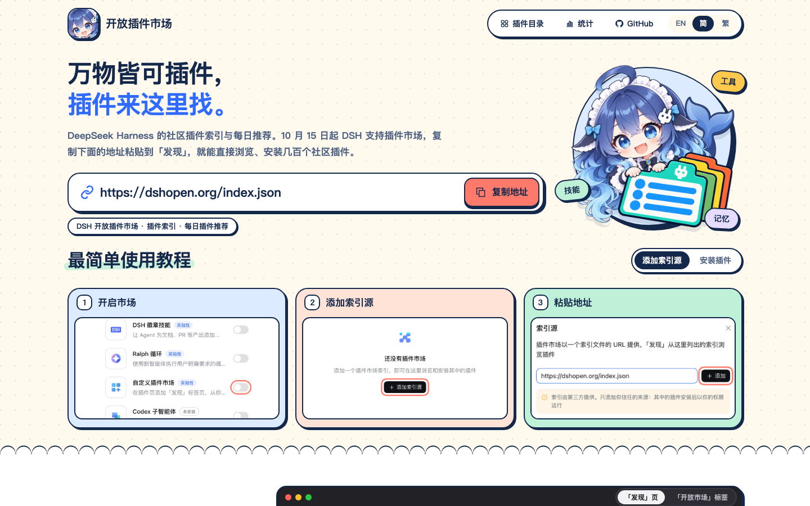
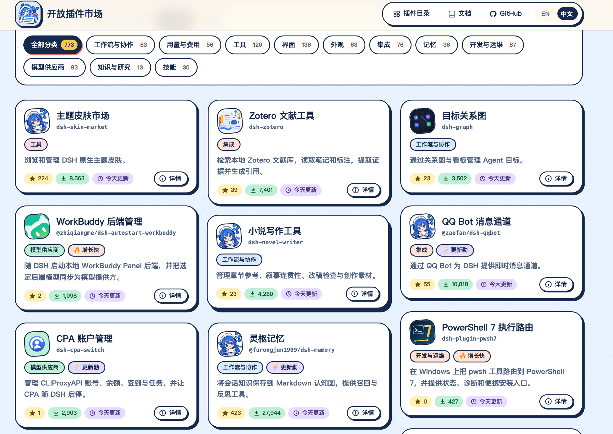

# Open Plugin Market · 开放插件市场


DeepSeek Harness 中打开 **插件 → 自定义插件市场**，再到 **发现 → 添加索引源** 粘贴：

```text
https://dshopen.org/index.json
```

[](https://dshopen.org/zh/)
[](https://dshopen.org/stats.json)
[](https://dshopen.org/stats.json)
[](https://github.com/polang233/dsh-plugin-index/stargazers)

DeepSeek Harness（DSH）的社区插件市场，数据为主、推荐为主，界面保持简洁。

**不只看 star🌟 数** 默认推荐每天会更新，以最近增长快、更新勤、优质的插件为主，同时参考验证、下载量和 star，同一作者不会霸榜。小开发者的新作品也能出现在首屏，被更多人看到。

[浏览目录](https://dshopen.org/zh/) · [English](README.en.md) · [提交插件](https://github.com/polang233/dsh-plugin-index/issues/new?template=plugin-add.yml)

<a href="docs/images/add-index.webp"></a>


## 使用

在 DSH 中任选一种方式：

**方式一：添加索引源**。在 **插件 → 实验性插件** 中打开 **自定义插件市场 → 发现 → 添加索引源**，粘贴 `https://dshopen.org/index.json`。

**方式二：安装插件**。运行下面的命令安装 `dsh-open-market`，它会自动把索引加入「发现」的索引源。并加载我们的市场插件，显示信息会更全一点

```bash
dsh plugin --profile desktop add "git+https://github.com/polang233/dsh-plugin-index.git#main&path:/packages/dsh-open-market"
```

[](https://dshopen.org/zh/)



## 推荐与标签

| 标签 | 含义 |
| --- | --- |
| ✅ 经过验证 | 被其他插件市场的人工或源码级验证收录 |
| 🔥 增长快 | 近 7 天下载量或 star 明显增长 |
| ⚡ 更新勤 | 近 30 天发版 ≥ 15 次 |
| ◷ 最近 / 本周 / 本月 / 三个月内更新 | 收录版本的发布时间 |
| ↓ 100+ … 10万+ | npm 近 30 天下载量，共 7 档 |

**默认排序**每周从有下载量、star 或验证记录的插件中选出约 70 个，每天轮换首页前十；本周展示过的会往后排，下周重新混排。**✨ 智能推荐**也每天换一批，以随机轮换为主，少量参考最近更新和增长。**随机资源**每天独立打乱。索引每 6 小时构建一次，轮换按台北时间的自然日计算。算法与曝光记录见 [指标说明](docs/market-display.md)。

## 别吝啬你的 star ⭐

star 是开发者最直接的鼓励，也是这里的推荐参考之一。用到哪个插件觉得好用，就去它的仓库点个 star 吧，没准下一个 star 就是别人点给你的。

## 提交插件

[填写收录申请](https://github.com/polang233/dsh-plugin-index/issues/new?template=plugin-add.yml)，或在 [`data/sources.json`](data/sources.json) 中添加条目后提交 PR。插件需要公开源码、可安装的 npm 版本和明确的许可证；经维护者确认也可使用固定 Git 提交，详见 [贡献指南](.github/CONTRIBUTING.md)。在 npm 包中附带自己的 Logo 会优先审核。

作者想下架自己的插件，请[填写下架申请](https://github.com/polang233/dsh-plugin-index/issues/new?template=plugin-remove.yml)。下架的插件记入 [`data/withdrawn.json`](data/withdrawn.json)，之后不会再被收录，除非作者本人重新申请。

每次构建都会核对发布包的完整性、包名、版本和组合包声明，再用官方校验器检查索引格式。包检查不代表代码审计或安装测试。[检查记录](https://dshopen.org/status.json)

## Star 趋势

<a href="https://www.star-history.com/#polang233/dsh-plugin-index&Date">
  <picture>
    <source media="(prefers-color-scheme: dark)" srcset="https://api.star-history.com/svg?repos=polang233/dsh-plugin-index&amp;type=Date&amp;theme=dark">
    
  </picture>
</a>

[维护说明](docs/maintenance.zh-CN.md) · [GPL-3.0 许可证](LICENSE)

独立社区项目，与 DeepSeek 官方无隶属关系。各插件的版权和许可证归原作者所有。
