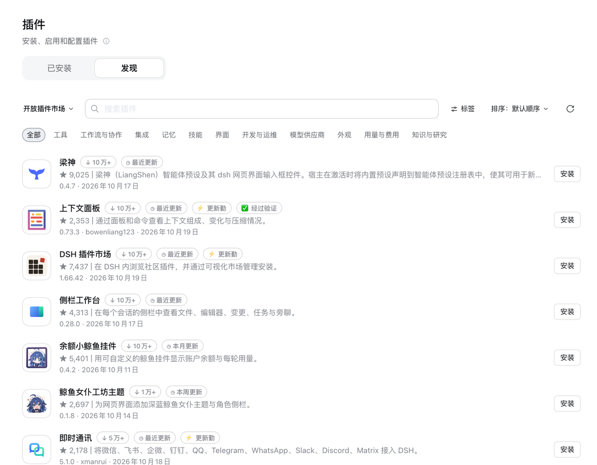
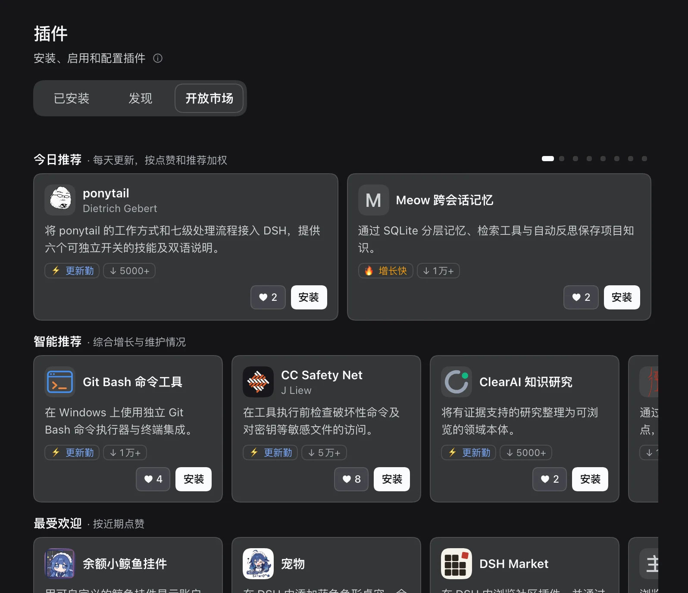
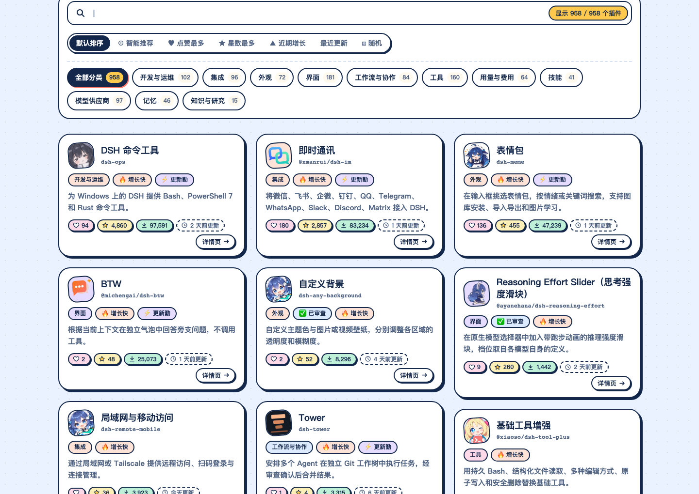

<div align="center">


# Open Plugin Market · 开放插件市场

[](https://dshopen.org/zh/)
[](https://dshopen.org/stats.json)
[](https://dshopen.org/stats.json)
[](https://github.com/polang233/dsh-plugin-index/stargazers)
[](https://www.npmjs.com/package/dsh-open-market)
[](https://dshopen.org/zh/plugins/dsh-open-market/)

[官网](https://dshopen.org/zh/) &nbsp;|&nbsp; [使用统计](https://dshopen.org/zh/stats/) &nbsp;|&nbsp; [提交插件](https://github.com/polang233/dsh-plugin-index/issues/new?template=plugin-add.yml) &nbsp;|&nbsp; [English](README.en.md)

</div>

DeepSeek Harness（DSH）的社区**插件市场**：可以作为官方「发现」的**索引源**添加，也可以安装插件，在 DSH 里获得独立的开放市场页面。

**不只看 star🌟 数** 默认推荐每天会更新，以最近增长快、更新勤、优质的插件为主，同时参考验证、下载量和 star，经典作品不会霸榜。新项目、小开发者的新作品有机会出现在首屏，被更多人看到。

## 快速使用

**方法 1：添加索引源**。在 **插件 → 实验性插件** 中打开 **自定义插件市场**，再到 **发现 → 添加索引源** 粘贴：

```text
https://dshopen.org/index.json
```

<p> </p>

**方法 2：安装插件**。运行下面的命令，[`dsh-open-market`](https://www.npmjs.com/package/dsh-open-market) 会自动打开自定义插件市场并加入索引，重启 DSH 后生效。

```bash
dsh plugin --profile desktop add dsh-open-market
```

它还会在「插件」页加一个 **开放市场** 标签：今日推荐、按点赞和增长排的推荐，点开卡片能看详情、点赞和安装。



[](https://dshopen.org/zh/)



## 推荐与标签

| 标签 | 含义 |
| --- | --- |
| ✅ 经过验证 | 被其他插件市场的人工或源码级验证收录 |
| 🔥 增长快 | 近 7 天下载量或 star 明显增长 |
| ⚡ 更新勤 | 近 30 天发版 ≥ 10 次 |
| ◷ 最近 / 本周 / 本月 / 三个月内更新 | 收录版本的发布时间 |
| ↓ 100+ … 10万+ | npm 近 30 天下载量，共 7 档 |
| ♥ 点赞 | 在开放市场标签里点赞或安装，每人每天每个插件计一次，每 3 天减 1 |

**默认排序**每周从有下载量、star 或验证记录的插件中选出约 70 个，每天轮换首页前十；本周展示过的会往后排，下周重新混排。**✨ 智能推荐**也每天换一批，以随机轮换为主，少量参考最近更新和增长。**随机资源**每天独立打乱。索引每 6 小时构建一次，轮换按 UTC+8 时间的自然日计算。算法与曝光记录见 [指标说明](docs/market-display.md)。

## 提交插件

[填写收录申请](https://github.com/polang233/dsh-plugin-index/issues/new?template=plugin-add.yml)：需要公开源码、可安装的 npm 版本和明确的许可证（经确认也可用固定 Git 提交，见[贡献指南](.github/CONTRIBUTING.md)），有自己的 Logo 和完善描述的优先审核。要下架请[填写下架申请](https://github.com/polang233/dsh-plugin-index/issues/new?template=plugin-remove.yml)。

收录后可以在你的 README 里放上徽章，显示点赞数，点击直达本站的插件页。把 `dsh-pet` 换成你的包名（scope 包写成 `%40scope/name`）：

```md
[](https://dshopen.org/zh/plugins/dsh-pet/)
```

[](https://dshopen.org/zh/plugins/dsh-pet/)

## 别吝啬你的 star ⭐

star🌟是开发者最直接的鼓励，也是这里的推荐参考之一。用到哪个插件很好用，就去它的仓库点个 star🌟 吧！没准下一个 star🌟 就是别人点给你的。

<a href="https://www.star-history.com/#polang233/dsh-plugin-index&Date">
  <picture>
    <source media="(prefers-color-scheme: dark)" srcset="https://api.star-history.com/svg?repos=polang233/dsh-plugin-index&amp;type=Date&amp;theme=dark">
    
  </picture>
</a>

[维护说明](docs/maintenance.zh-CN.md) · [GPL-3.0 许可证](LICENSE)

独立社区项目，与 DeepSeek 官方无隶属关系。各插件的版权和许可证归原作者所有。
