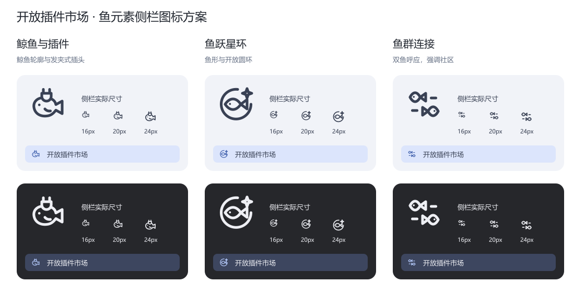

# 侧栏图标

侧栏采用「鲸鱼与插件」方案，使用 `currentColor` 单色线条、24 × 24 坐标和 1.7 线宽，随 DSH 主题与选中状态变色。对照图保留三版方案的浅深色主题、16/20/24 像素尺寸和侧栏按钮效果。

| 方案 | 图形 | 用意 |
| --- | --- | --- |
| [鲸鱼与插件](assets/sidebar-fish-plug.svg) | 圆润鲸身、鱼尾与发夹式插头 | 已选用，结合鱼元素、头像发夹和插件功能 |
| [鱼跃星环](assets/sidebar-fish-orbit.svg) | 鱼形、开放圆环与星点 | 强调发现与连接 |
| [鱼群连接](assets/sidebar-fish-community.svg) | 两条相向的小鱼与连接线 | 强调社区交流与插件集合 |

鲸鱼轮廓在小尺寸下易辨认，插头对应插件市场，也呼应头像上的发夹。
